# Multi-Inbox Temporary Email Platform — System Design Whiteboard

> Self-hosted, anonymous, multi-inbox disposable email (Temp-Mail style).
> **Differentiator:** one anonymous session owns many live addresses at once, all feeding a **Unified Inbox** in real time.

**Stack:** Next.js · NestJS · PostgreSQL · Redis · BullMQ · Postfix · mailparser · SSE · TanStack Query · Docker Compose · Nginx · S3-compatible object storage

---

## 0. Legend and Architecture at a Glance

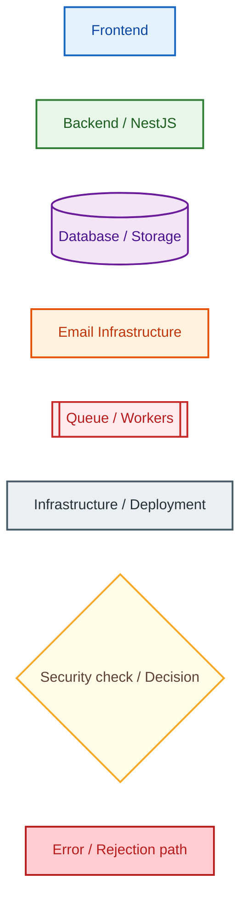

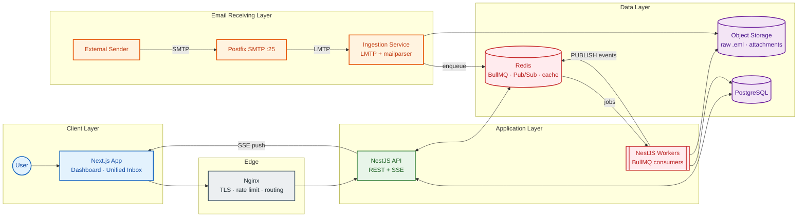

---

## 1. User / Frontend Layer

### 1a. User Journey

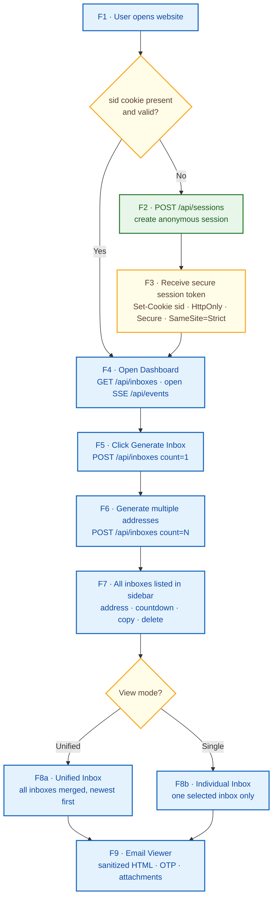

### 1b. Frontend Component Tree

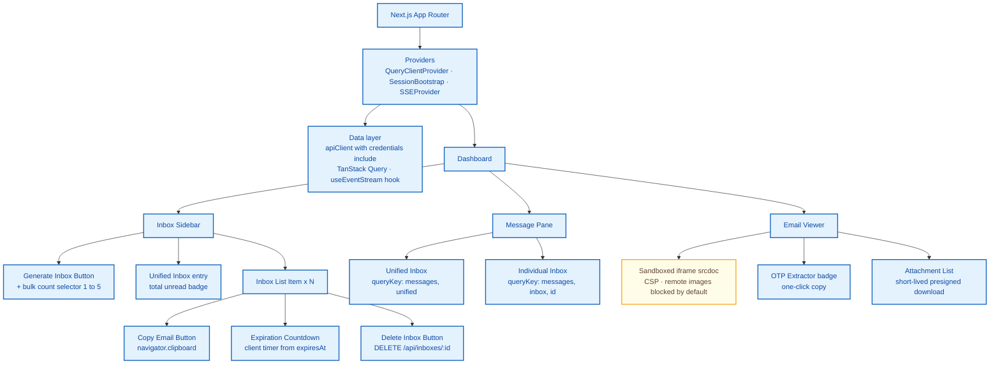

| Component | Data source | Notes |
|---|---|---|
| Inbox Sidebar | `GET /api/inboxes` → `['inboxes']` | Updated by `setQueryData` after create/delete and by SSE events |
| Unified Inbox | `GET /api/messages?view=unified&cursor=` | Infinite query, each row shows the originating address chip |
| Individual Inbox | `GET /api/messages?inboxId=:id&cursor=` | Same list component, filtered |
| Email Viewer | `GET /api/messages/:id` | Marks read, renders `html_sanitized` in sandboxed iframe |
| Expiration Countdown | `expiresAt` from inbox payload | Purely client-side, server event `INBOX_EXPIRED` is the source of truth |

---

## 2. Anonymous Session Management

### 2a. Session Creation and Validation

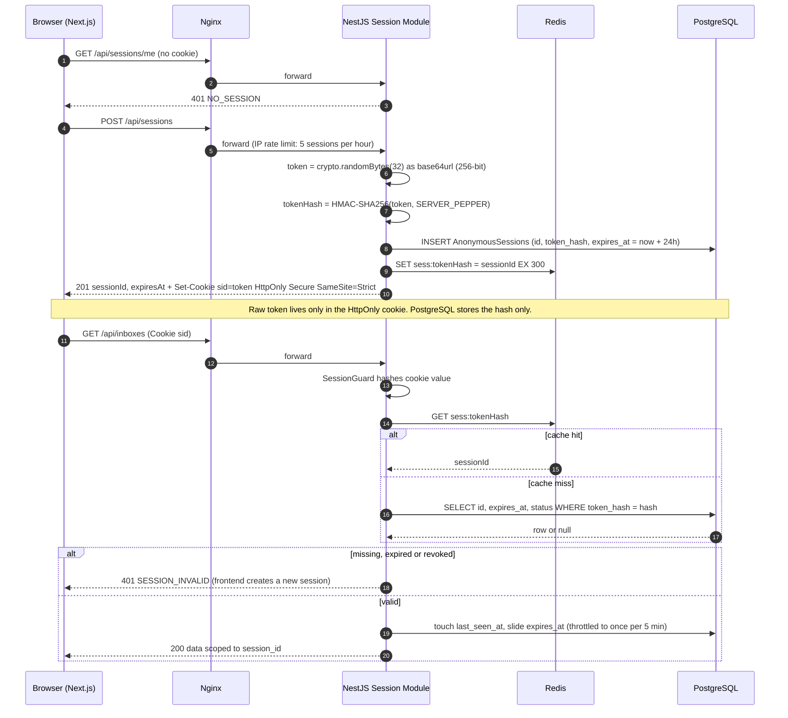

### 2b. Ownership Model

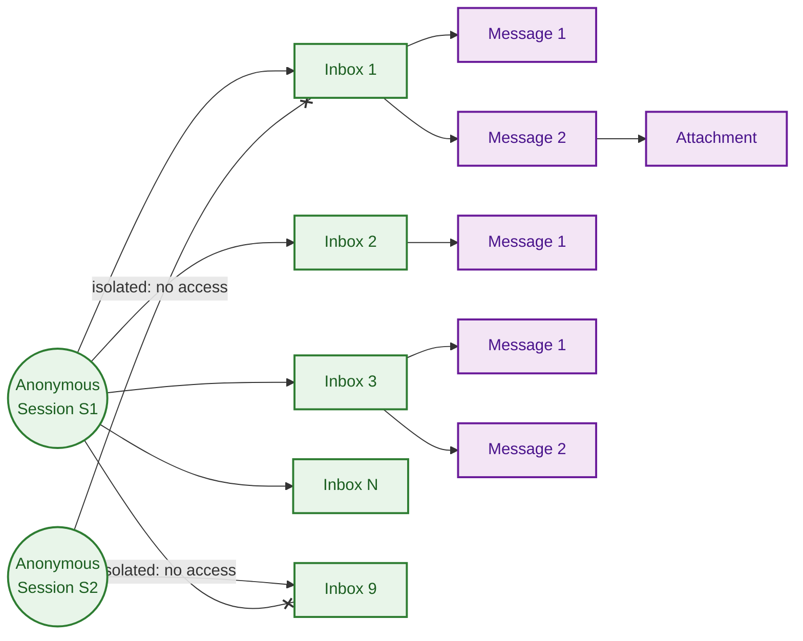

### 2c. Authorization Check on Every Request

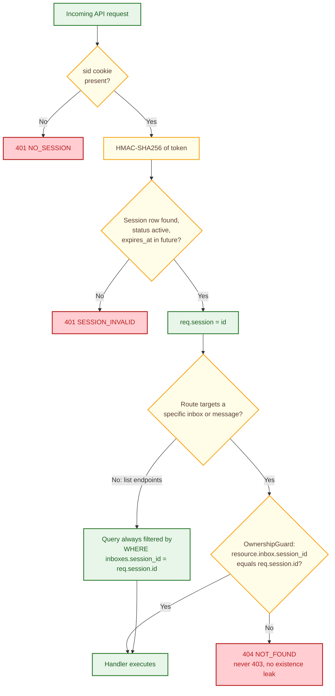

---

## 3. Inbox Generation Workflow

### 3a. Single and Bulk Generation (same endpoint)

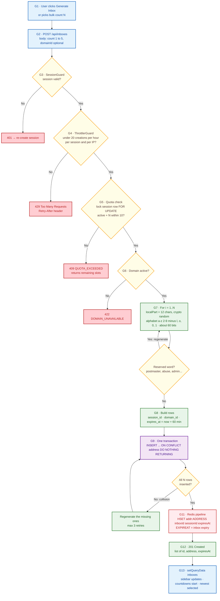

### 3b. Bulk Example: User Requests 5 Inboxes

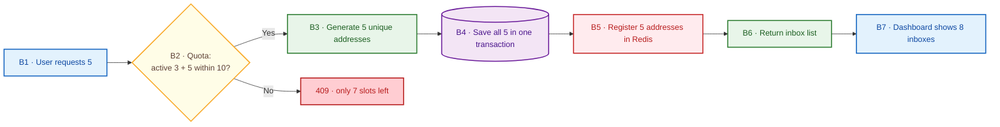

---

## 4. Email Receiving Infrastructure (Core Pipeline)

```mermaid
flowchart TD
  subgraph EXTZ["External"]
    E1["E1 · External Sender MTA<br/>to: abc123@yourdomain.com"]:::mail
  end
  subgraph DNSZ["DNS"]
    E2["E2 · MX lookup<br/>yourdomain.com MX 10 mx.yourdomain.com"]:::infra
  end

  subgraph MTA["Mail Server VPS · Postfix"]
    E3["E3 · postscreen + smtpd :25<br/>STARTTLS · connection rate limits"]:::mail
    D0{"Client passes RBL,<br/>pregreet and rate checks?"}:::sec
    E4["E4 · RCPT TO stage<br/>check_policy_service"]:::mail
    E5["E5 · Recipient Policy Service<br/>Redis HGETALL addr:ADDRESS<br/>fallback PostgreSQL"]:::mail
    D1{"Address exists?"}:::sec
    D2{"Inbox active and<br/>expiresAt in future?"}:::sec
    E6["E6 · DATA stage"]:::mail
    D3{"Size within<br/>message_size_limit 10 MB?"}:::sec
    E7["E7 · LMTP handoff<br/>transport lmtp:inet:ingest:2525"]:::mail
  end

  R0["421 / 554 reject<br/>connection dropped"]:::err
  R1["550 5.1.1 User unknown<br/>rejected at RCPT, no bounce"]:::err
  R2["550 5.1.1 Mailbox expired"]:::err
  R3["552 5.3.4 Message too large"]:::err

  subgraph INGZ["Email Ingestion Service · NestJS + LMTP"]
    E8["E8 · Stream raw .eml<br/>to object storage raw/ · TTL 7 days"]:::mail
    E9["E9 · Parse MIME<br/>mailparser simpleParser<br/>limits: depth, part count"]:::mail
    D4{"Parse OK?"}:::sec
    E10["E10 · Validate headers<br/>and attachments: count, size, type"]:::mail
    D5{"All attachments<br/>allowed?"}:::sec
    E11["E11 · Strip blocked attachments<br/>keep metadata, is_blocked = true"]:::mail
    E12["E12 · Resolve inbox<br/>address → inbox_id, session_id"]:::mail
    E13["E13 · dedupe_hash =<br/>SHA-256 of Message-ID + body"]:::mail
    E14["E14 · Enqueue BullMQ job<br/>queue email-processing<br/>jobId = inboxId:dedupeHash"]:::queue
    D6{"Enqueue OK?"}:::sec
    E15["E15 · LMTP 250 OK"]:::mail
  end

  R4["Quarantine raw .eml<br/>log PARSE_FAILED · metric<br/>reply 250, no backscatter"]:::err
  R5["LMTP 451 4.3.0 temporary failure<br/>Postfix keeps mail and retries"]:::err

  subgraph QZ["Redis · BullMQ"]
    Q1[["email-processing queue"]]:::queue
  end

  subgraph WZ["Email Processing Worker"]
    W1["W1 · Pick up job"]:::queue
    D7{"Duplicate?<br/>UNIQUE inbox_id + dedupe_hash"}:::sec
    D8{"Inbox still active?<br/>race with expiry"}:::sec
    W2["W2 · Sanitize HTML<br/>sanitize-html allowlist<br/>strip scripts, forms, event handlers"]:::queue
    W3["W3 · Upload attachments<br/>object storage att/"]:::queue
    W4["W4 · DB transaction<br/>INSERT Messages, Attachments,<br/>EmailEvents RECEIVED"]:::db
    D9{"DB write OK?"}:::sec
    D10{"Attempts left?<br/>max 5, exponential backoff"}:::sec
    W5["W5 · OTP extraction job<br/>regex patterns + keyword scoring"]:::queue
    W6["W6 · UPDATE Messages.otp_code<br/>EmailEvent OTP_EXTRACTED"]:::db
    W7["W7 · PUBLISH Redis<br/>events:session:SESSION_ID<br/>NEW_EMAIL"]:::queue
  end

  R6["Ack and drop<br/>EmailEvent DUPLICATE"]:::err
  R7["Discard, delete raw object<br/>log EXPIRED_ON_ARRIVAL"]:::err
  R8["Dead-letter queue<br/>alert · raw kept for replay"]:::err

  subgraph RTZ["Real-time Delivery"]
    RT1["RT1 · NestJS SSE Gateway<br/>subscribed to events:session:*"]:::be
    RT2["RT2 · Authenticated session stream<br/>event NEW_EMAIL"]:::be
    RT3["RT3 · Browser EventSource<br/>TanStack Query invalidation"]:::fe
    RT4["RT4 · New email displayed"]:::fe
  end

  E1 --> E2 --> E3 --> D0
  D0 -->|"No"| R0
  D0 -->|"Yes"| E4 --> E5 --> D1
  D1 -->|"No"| R1
  D1 -->|"Yes"| D2
  D2 -->|"No"| R2
  D2 -->|"Yes"| E6 --> D3
  D3 -->|"No"| R3
  D3 -->|"Yes"| E7 --> E8 --> E9 --> D4
  D4 -->|"No"| R4
  D4 -->|"Yes"| E10 --> D5
  D5 -->|"No"| E11 --> E12
  D5 -->|"Yes"| E12
  E12 --> E13 --> E14 --> D6
  D6 -->|"No: Redis down"| R5
  D6 -->|"Yes"| E15
  E14 --> Q1 --> W1 --> D7
  D7 -->|"Yes"| R6
  D7 -->|"No"| D8
  D8 -->|"No"| R7
  D8 -->|"Yes"| W2 --> W3 --> W4 --> D9
  D9 -->|"No"| D10
  D10 -->|"Yes: retry"| Q1
  D10 -->|"No"| R8
  D9 -->|"Yes"| W5 --> W6 --> W7 --> RT1 --> RT2 --> RT3 --> RT4

  classDef fe fill:#E3F2FD,stroke:#1565C0,color:#0D47A1,stroke-width:2px
  classDef be fill:#E8F5E9,stroke:#2E7D32,color:#1B5E20,stroke-width:2px
  classDef db fill:#F3E5F5,stroke:#6A1B9A,color:#4A148C,stroke-width:2px
  classDef mail fill:#FFF3E0,stroke:#E65100,color:#BF360C,stroke-width:2px
  classDef queue fill:#FFEBEE,stroke:#C62828,color:#B71C1C,stroke-width:2px
  classDef infra fill:#ECEFF1,stroke:#455A64,color:#263238,stroke-width:2px
  classDef sec fill:#FFFDE7,stroke:#F9A825,color:#5D4037,stroke-width:2px
  classDef err fill:#FFCDD2,stroke:#B71C1C,color:#B71C1C,stroke-width:2px
```

### Failure Handling Matrix

| Condition | Detected at | Response to sender | Internal action |
|---|---|---|---|
| Recipient does not exist | Postfix RCPT TO via policy service | `550 5.1.1` reject in-session | Metric `smtp_rcpt_unknown`; no bounce generated (rejecting during SMTP avoids backscatter) |
| Inbox expired | Policy service (expiresAt check) | `550 5.1.1` | Address key already removed by expiration job; worker re-checks in case of race |
| Email too large | Postfix `message_size_limit` (also ESMTP SIZE at MAIL FROM) | `552 5.3.4` | Ingestion also enforces a streaming byte cap as a second line of defense |
| MIME parsing fails | Ingestion service | `250` accepted | Raw .eml moved to `quarantine/`, `PARSE_FAILED` logged, alert if rate spikes |
| Duplicate email | BullMQ jobId + DB unique index `(inbox_id, dedupe_hash)` | `250` | Acked and dropped, `DUPLICATE` event logged |
| Queue unavailable | Ingestion enqueue | `451 4.3.0` temp failure | Postfix keeps message in its own queue and retries |
| Database storage fails | Worker transaction | already `250` | BullMQ retries (5 attempts, exponential backoff from 2s), then DLQ + alert; raw .eml kept for replay |

---

## 5. Multi-Inbox and Unified Inbox Architecture

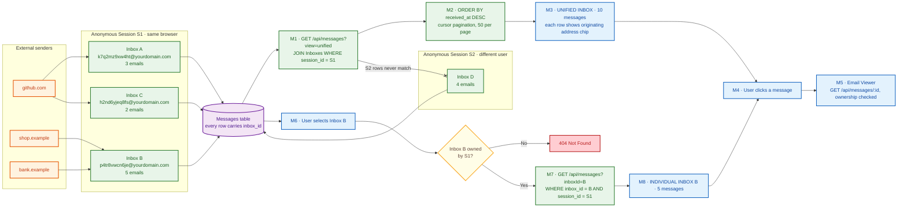

**Isolation rule:** the session id never comes from the client. It is always derived server-side from the cookie, and every message query is joined through `Inboxes.session_id`. Index `messages (inbox_id, received_at DESC)` plus `inboxes (session_id, status)` keeps the unified query fast.

---

## 6. Backend Architecture (NestJS Monorepo, 3 Deployable Apps)

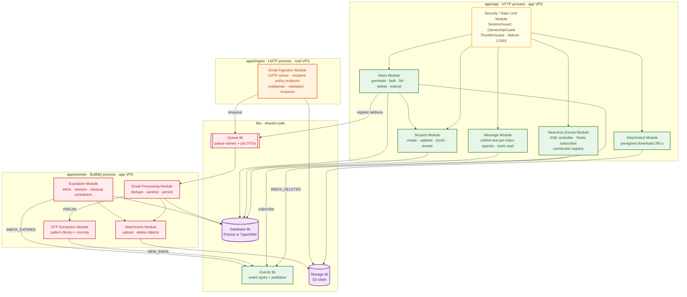

### REST / SSE API Surface

| Method | Path | Module | Guards |
|---|---|---|---|
| POST | `/api/sessions` | Session | IP throttle |
| GET | `/api/sessions/me` | Session | Session |
| POST | `/api/inboxes` `{count}` | Inbox | Session, Throttle, Quota |
| GET | `/api/inboxes` | Inbox | Session |
| PATCH | `/api/inboxes/:id/extend` | Inbox | Session, Ownership |
| DELETE | `/api/inboxes/:id` | Inbox | Session, Ownership |
| GET | `/api/messages?view=unified&cursor=` | Message | Session |
| GET | `/api/messages?inboxId=&cursor=` | Message | Session, Ownership |
| GET | `/api/messages/:id` | Message | Session, Ownership |
| DELETE | `/api/messages/:id` | Message | Session, Ownership |
| GET | `/api/attachments/:id/download` | Attachment | Session, Ownership |
| GET | `/api/events` (SSE) | Real-time | Session |
| POST | `internal: /policy/recipient` (private network only) | Ingestion | mTLS / private bind |

---

## 7. Database Architecture (PostgreSQL)

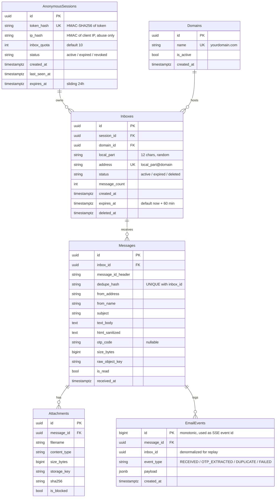

| Table | Key indexes / constraints |
|---|---|
| AnonymousSessions | `UNIQUE(token_hash)`, `INDEX(expires_at)` |
| Inboxes | `UNIQUE(address)`, `INDEX(session_id, status)`, `INDEX(expires_at) WHERE status = 'active'` |
| Messages | `UNIQUE(inbox_id, dedupe_hash)`, `INDEX(inbox_id, received_at DESC)` |
| Attachments | `INDEX(message_id)` |
| EmailEvents | `INDEX(inbox_id, id)` for Last-Event-ID replay |
| FKs | `ON DELETE CASCADE` from Sessions → Inboxes → Messages → Attachments / EmailEvents (object storage cleaned by job) |

---

## 8. Background Job Architecture (Redis + BullMQ)

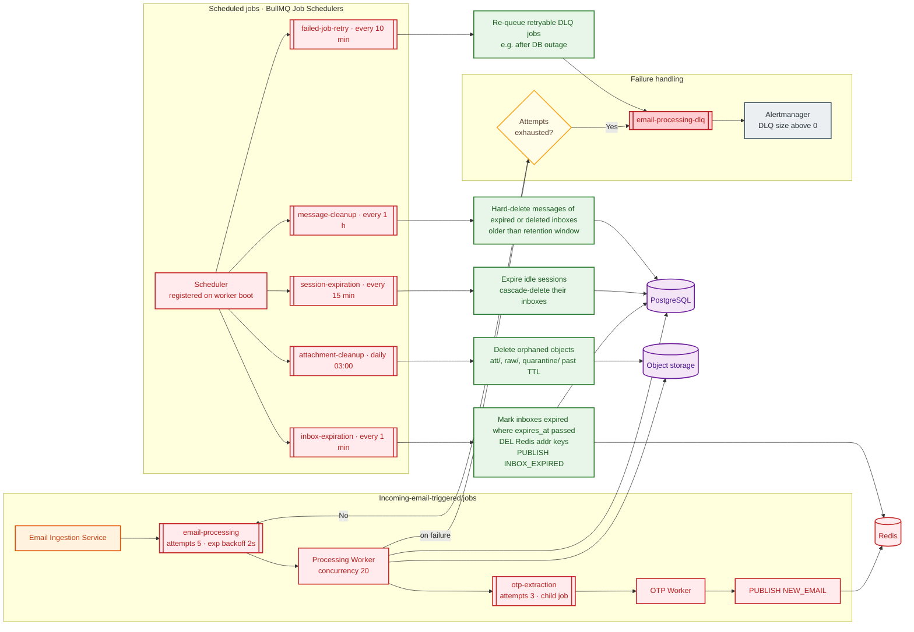

| Job | Trigger | Payload | Retry |
|---|---|---|---|
| email-processing | Ingestion enqueue | `inboxId, sessionId, rawObjectKey, parsedRef, dedupeHash` | 5, exponential |
| otp-extraction | Child of processing (BullMQ FlowProducer) | `messageId` | 3 |
| inbox-expiration | Every 1 min | — | Idempotent, next tick |
| session-expiration | Every 15 min | — | Idempotent |
| message-cleanup | Hourly | — | Idempotent, batched deletes |
| attachment-cleanup | Daily | — | Idempotent |
| failed-job-retry | Every 10 min | DLQ scan | Manual override possible |

**Redis keys:** `addr:ADDRESS` (hash: inboxId, sessionId, expiresAt) · `sess:TOKEN_HASH` (cache, 5 min) · `rl:*` (throttler counters) · `bull:*` (BullMQ) · Pub/Sub channel `events:session:SESSION_ID`.

---

## 9. Real-time Architecture (SSE)

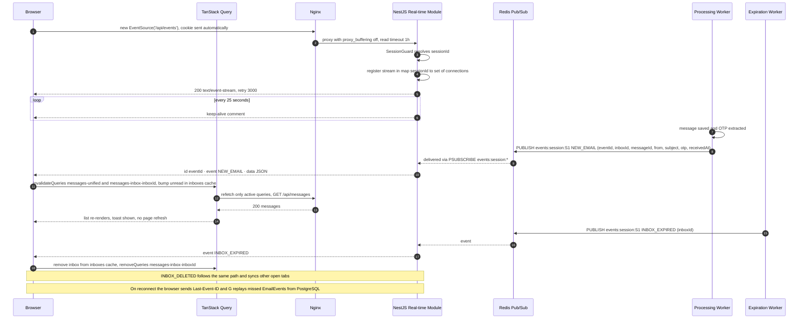

| Event | Published by | Payload | Frontend reaction |
|---|---|---|---|
| `NEW_EMAIL` | Processing / OTP worker | `inboxId, messageId, from, subject, otp, receivedAt` | Invalidate unified + that inbox's list, unread badge +1, toast with OTP copy |
| `INBOX_EXPIRED` | Expiration worker | `inboxId` | Remove from sidebar, drop its message queries, switch to unified if selected |
| `INBOX_DELETED` | Inbox Module | `inboxId` | Same as above (cross-tab sync) |

---

## 10. Infrastructure and Deployment

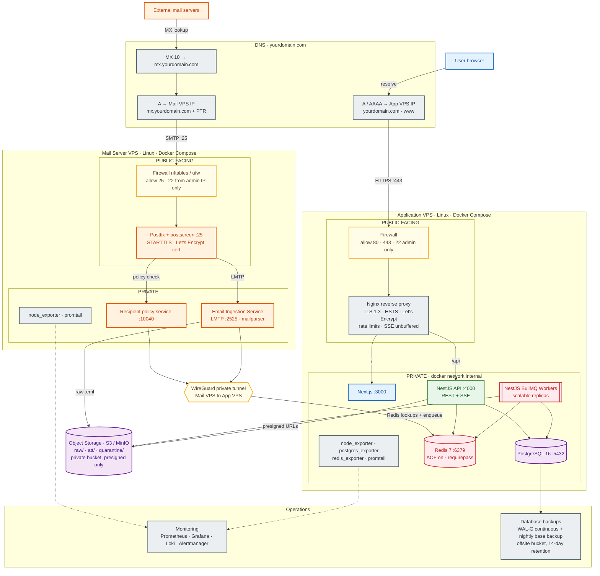

| Host | Port | Exposure | Service |
|---|---|---|---|
| Mail VPS | 25 | Public | Postfix SMTP |
| Mail VPS | 22 | Admin IP only | SSH (key auth) |
| Mail VPS | 2525, 10040 | Localhost / docker network | LMTP ingestion, policy service |
| App VPS | 80 → 443 | Public | Nginx (redirect + TLS) |
| App VPS | 3000, 4000 | Docker network only | Next.js, NestJS API |
| App VPS | 5432, 6379 | Docker network + WireGuard only | PostgreSQL, Redis |
| Both | 51820/udp | Peer IP only | WireGuard tunnel |

**DNS notes:** receive-only service needs `MX`, `A` for the MX host, and a `PTR` matching it. Publish `SPF -all` and a `DMARC p=reject` record so nobody can send *as* your domain.

---

## 11. Security Architecture

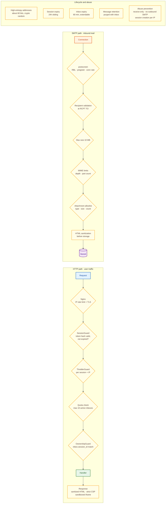

| Control | Where enforced | Default |
|---|---|---|
| Session token validation | NestJS SessionGuard | 256-bit token, HMAC-SHA256 hash stored, HttpOnly + Secure + SameSite=Strict cookie |
| Inbox ownership verification | OwnershipGuard + query scoping | 404 on mismatch |
| High-entropy address generation | Inbox Module | 12 chars from 32-char alphabet via `crypto.randomInt`, reserved-word blocklist |
| Rate limiting | Nginx `limit_req` + NestJS Throttler (Redis store) | 60 req/min API, 5 sessions/hour/IP, 20 inbox creations/hour |
| Inbox creation quota | Inbox Module (row lock) | 10 active per session, 5 per bulk request |
| SMTP recipient validation | Postfix `check_policy_service` | Reject unknown/expired at RCPT with 550 |
| Max email size | Postfix `message_size_limit` + ingestion stream cap | 10 MB |
| HTML sanitization | Worker (sanitize-html) + iframe `sandbox` + CSP | No scripts, forms, iframes, event handlers; remote images blocked until user opts in |
| Attachment restrictions | Ingestion + Worker | Max 5 MB each, 10 per message; block exe, js, scr, bat, msi, vbs, macro Office types; served with `Content-Disposition: attachment` and `X-Content-Type-Options: nosniff` |
| Session expiration | session-expiration job | 24h idle |
| Message retention | message-cleanup job | Deleted with inbox, hard cap 24h |
| Abuse prevention | Architecture | Receive-only (no outbound relay), SPF/DMARC reject, monitoring of session/inbox creation spikes, optional proof-of-work or CAPTCHA on session creation under load |
| Secrets | Docker secrets / env files | `SERVER_PEPPER`, DB and Redis passwords never in images |
| CSRF | SameSite=Strict + required custom header `X-Requested-With` on mutations | — |

---

## 12. Complete End-to-End System Flow

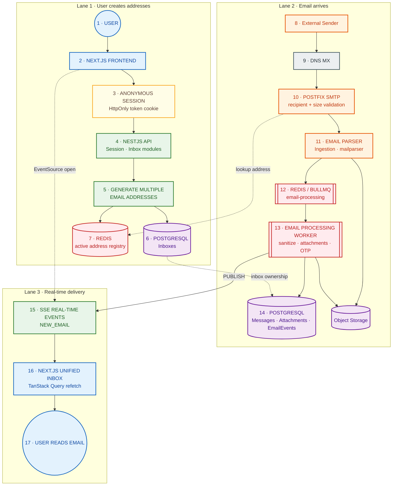

---

## Appendix A · Key Design Decisions

| Decision | Choice | Why |
|---|---|---|
| Token storage | HttpOnly cookie, not localStorage | Immune to XSS token theft; `EventSource` sends cookies automatically (it cannot set headers) |
| Recipient rejection | At SMTP `RCPT TO`, not after accepting | Avoids generating bounces to forged senders (backscatter) and wasted processing |
| Postfix → app handoff | LMTP to a NestJS ingestion service | Clean status codes (250/451) map directly to success/temporary failure |
| Raw email first to object storage | Before parsing | Enables replay after parse or DB failures; keeps Redis job payloads small |
| Dedupe | BullMQ `jobId` + DB unique index | Two layers: in-flight duplicates and already-stored duplicates |
| Real-time transport | SSE over Redis Pub/Sub | One-way server push is all that is needed; works through Nginx; scales across API replicas |
| Mail and app on separate VPS | Yes | Port 25 reputation and attack surface isolated from the web app; joined by WireGuard |
| One NestJS monorepo, 3 apps | api, ingest, worker | Shared entities and DTOs, independent scaling and deployment |

## Appendix B · Default Configuration

| Setting | Value |
|---|---|
| Session TTL | 24h sliding |
| Inbox TTL | 60 min (extend up to 24h) |
| Max active inboxes per session | 10 |
| Max inboxes per bulk request | 5 |
| Max message size | 10 MB |
| Max attachment size / count | 5 MB / 10 |
| Processing job attempts | 5, exponential from 2s |
| SSE heartbeat | 25s |
| Unified inbox page size | 50, cursor on `(received_at, id)` |

---

## How to Convert This File into Images

Every diagram is a Mermaid block, so you can export all of them at once:

```bash
npm install -g @mermaid-js/mermaid-cli
mmdc -i temp-mail-system-design.md -o whiteboard.png -s 3 -b white
# produces whiteboard-1.png, whiteboard-2.png, ... one per diagram
```

Use `-o whiteboard.svg` for crisp vector output. For a single diagram, paste the block into **mermaid.live** and export PNG/SVG. GitHub, GitLab, Obsidian and Notion also render these blocks directly.
